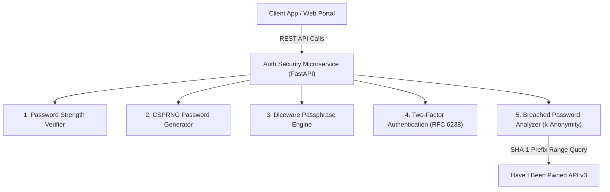

# Auth Security Microservice: Password Protection & 2FA Lifecycle Management

A comprehensive, standalone security microservice architected to operate as security middleware across the authentication lifecycle of external applications. Built with **FastAPI**, **CSPRNG cryptographic primitives**, and **Pydantic v2**.

---

## 1. Architectural Overview

The service acts as an independent security gateway / middleware that external clients (e.g. mobile applications, web frontends, authentication servers) query via a high-performance RESTful API.



---

## 2. Implemented Functional Components

### 2.1. Password Strength Verifier
Evaluates complexity based on:
1. **Combinatorial Keyspace Entropy**:
   $$H_{\text{combinatorial}} = L \cdot \log_2(R)$$
   Where $L$ is password length and $R$ is the size of the active character pool:
   $$R = 26 \cdot \mathbb{I}_{\text{lower}} + 26 \cdot \mathbb{I}_{\text{upper}} + 10 \cdot \mathbb{I}_{\text{digit}} + 32 \cdot \mathbb{I}_{\text{symbol}} + \dots$$
2. **Shannon Informational Entropy**:
   $$H_{\text{shannon}} = -\sum_{i=1}^{k} p(c_i) \log_2 p(c_i)$$
3. **Pattern Penalties**:
   - Consecutive identical characters ($aaa \dots$)
   - Sequential ascending/descending alphanumeric sequences ($abc$, $123$, $321$)
   - Common QWERTY keyboard walking sequences ($qwerty$, $asdfgh$)
   - Common breach dictionary matches
4. **Adversary Crack Time Modeling**:
   Calculates average time to crack $50\%$ keyspace ($2^{H_{\text{effective}} - 1}$ guesses) across:
   - Online Throttled ($100$ attempts / hour)
   - Online Unthrottled ($1,000$ attempts / sec)
   - Offline Slow Hash ($10,000$ bcrypt hashes / sec)
   - Offline Fast Hash ($10^{11}$ MD5/SHA-256 GPU hashes / sec)
5. **OWASP ASVS Compliance Check**:
   Evaluates minimum length ($\ge 8$, recommends $\ge 12$), character diversity, and dictionary presence.

---

### 2.2. Secure Password Generator
- Uses operating system Cryptographically Secure Pseudo-Random Number Generators (CSPRNG): `secrets.SystemRandom` (`CryptGenRandom` / `/dev/urandom`).
- **Guaranteed Pool Representation**: Guarantees at least one character from each requested pool (lowercase, uppercase, digits, symbols).
- **Cryptographic Fisher-Yates Shuffle**: Positions characters randomly using CSPRNG uniform sampling `secrets.randbelow(i + 1)`.
- **Ambiguous Character Filtering**: Eliminates visually confusing characters (`0`, `O`, `1`, `l`, `I`).

---

### 2.3. Diceware Passphrase Generator
- Implements Arnold Reinhold's classic **Diceware method**.
- Simulates 5 rolls of physical 6-sided dice per word ($6^5 = 7,776$ unique combinations) using CSPRNG.
- Bundles the curated **EFF Large Wordlist** (7,776 words).
- **Information Entropy**:
  $$H_{\text{base}} = N \cdot \log_2(7,776) = N \cdot 12.9248\text{ bits}$$
  Additional entropy calculated when adding random digits ($+ \log_2(10) \approx 3.32\text{ bits}$) or symbols ($+ \log_2(10) \approx 3.32\text{ bits}$).

---

### 2.4. Two-Factor Authentication (2FA) via TOTP
- Conforms strictly to **RFC 6238** (Time-based One-Time Password) and **RFC 4226** (HMAC-based HOTP).
- **Secret Generation**: Cryptographically generates 160-bit (20-byte) Base32 secrets.
- **Time-Step Counter $T$**:
  $$T = \left\lfloor \frac{\text{Current\_Unix\_Time} - T_0}{X} \right\rfloor \quad (X = 30\text{ seconds})$$
- **Dynamic Truncation**:
  - $HMAC = \text{HMAC-SHA1}(K, \text{struct.pack}(">Q", T))$
  - $\text{offset} = HMAC[19] \ \& \ 0x0F$
  - $\text{code} = (\text{big\_endian\_uint32}(HMAC[\text{offset}:\text{offset}+4]) \ \& \ 0x7FFFFFFF) \pmod{10^6}$
- **QR Code Generation**: Generates scannable `otpauth://totp/...` data URI PNG images.
- **Clock Drift Tolerance**: Validates tokens within a configurable window (default $\pm 1$ step = $\pm 30$ seconds) to absorb clock skew and network latency.

---

### 2.5. Breached Passwords Analysis (k-Anonymity Model)
- Integrates with **Have I Been Pwned (HIBP) API v3**.
- **Zero-Knowledge Privacy Proof**:
  1. Plaintext password is **NEVER** sent over the network.
  2. Full SHA-1 hash is **NEVER** sent over the network.
  3. Microservice computes SHA-1 hash locally.
  4. Only the first **5 hexadecimal characters** (20 bits) are sent to `https://api.pwnedpasswords.com/range/{prefix}` with `Add-Padding: true`.
  5. The remaining **35 hexadecimal characters** (140 bits) are matched locally against the returned suffix list.
  6. Includes local fallback dictionary heuristics if external network is unavailable.

---

## 3. Quick Start & Execution

### 3.1. Requirements
- Python 3.10+ (tested on Python 3.14)
- Dependencies installed:
  ```powershell
  pip install -r requirements.txt
  ```

### 3.2. Running the Microservice
```powershell
python run.py
```
Or directly with uvicorn:
```powershell
uvicorn app.main:app --host 0.0.0.0 --port 8000 --reload
```

Once running:
- **Interactive Web Dashboard**: [http://localhost:8000/](http://localhost:8000/)
- **Interactive OpenAPI / Swagger UI**: [http://localhost:8000/docs](http://localhost:8000/docs)
- **ReDoc Documentation**: [http://localhost:8000/redoc](http://localhost:8000/redoc)

---

## 4. Running Automated Tests

A comprehensive test suite with 28 automated tests covers all components and RFC test vectors:
```powershell
python -m pytest auth_security_service/tests -v
```

---

## 5. API Reference Summary

| Method | Endpoint | Description |
|---|---|---|
| `POST` | `/api/v1/password/verify` | Evaluates complexity, Shannon entropy, crack times, and OWASP compliance. |
| `POST` | `/api/v1/password/generate` | Generates CSPRNG passwords with guaranteed pool representation. |
| `POST` | `/api/v1/passphrase/generate` | Generates memorable Diceware passphrases with 7776-word EFF dictionary. |
| `POST` | `/api/v1/2fa/setup` | Initializes 160-bit Base32 secret, `otpauth://` URI, and QR code data URL. |
| `POST` | `/api/v1/2fa/verify` | Verifies 6-digit TOTP token with clock drift tolerance. |
| `POST` | `/api/v1/2fa/current-code` | Helper to generate current token for a secret (for testing). |
| `POST` | `/api/v1/breach/check` | Queries HIBP API v3 using the k-Anonymity model. |
| `POST` | `/api/v1/middleware/audit-registration` | All-in-one registration gate: verifies strength and checks breach history. |
| `GET` | `/api/v1/health` | Service health status. |

---

## 6. Docker Deployment

Build and run using Docker:
```bash
docker build -t auth-security-service .
docker run -p 8000:8000 auth-security-service
```
Or via Docker Compose:
```bash
docker-compose up -d
```
